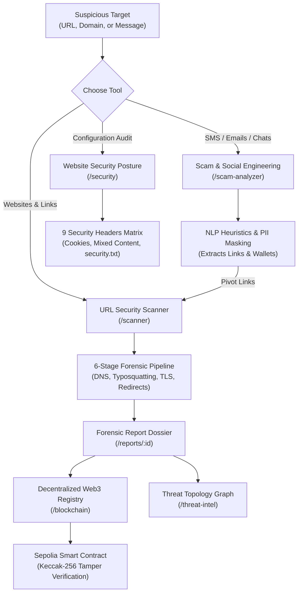
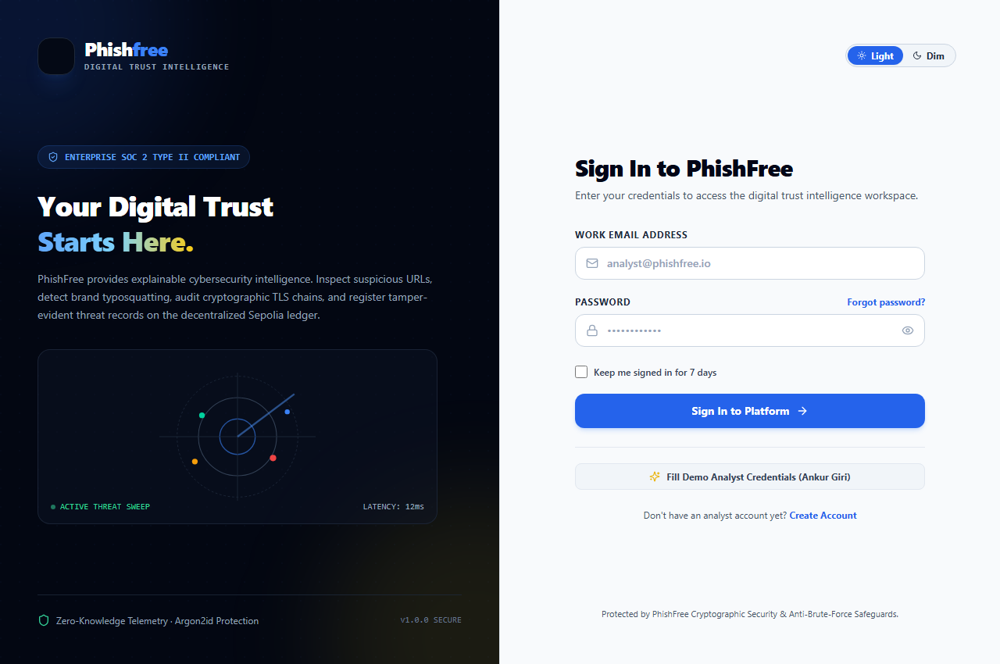
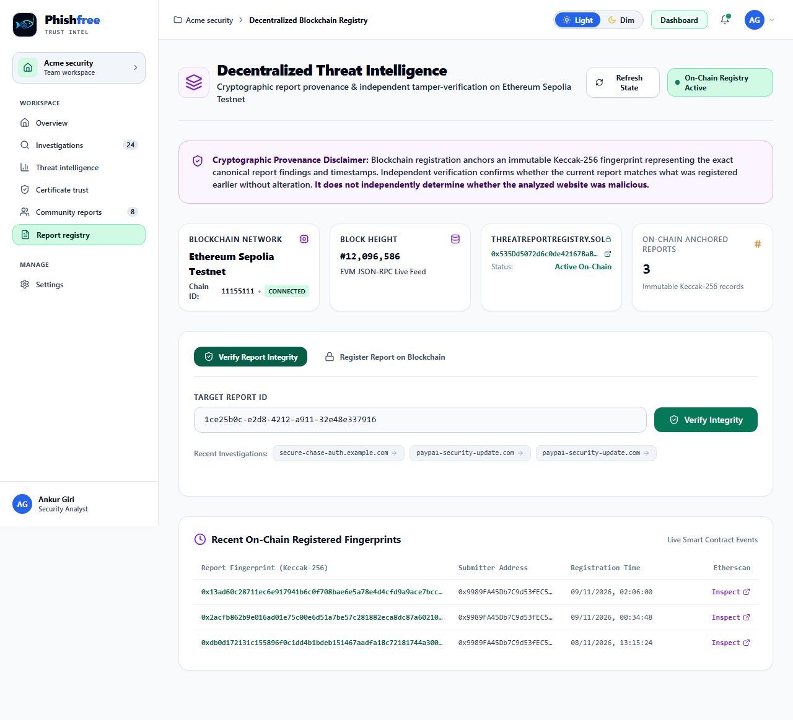
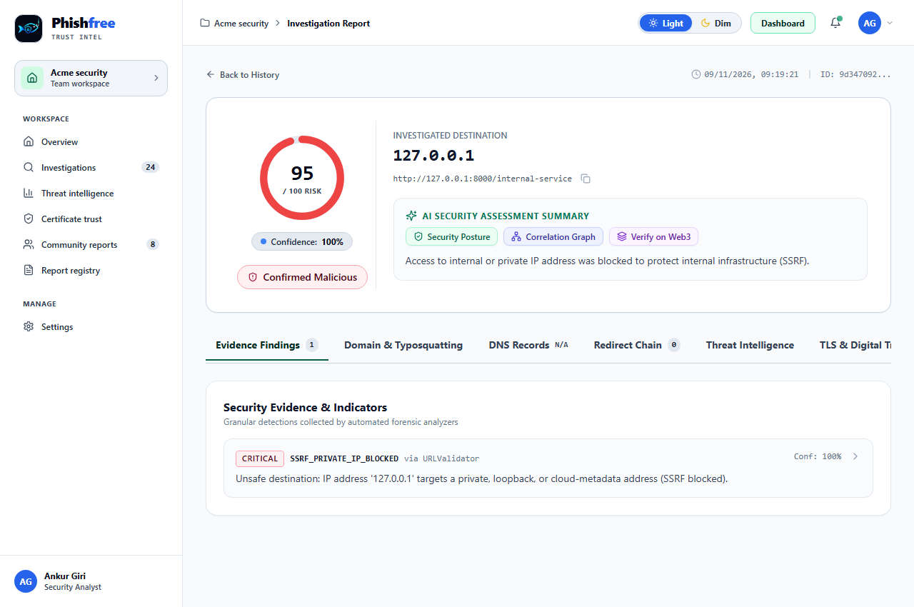

# PhishFree — Trust Every Click

[](https://github.com/ncode5/Phishfree)
[](https://phishfree-rust.vercel.app)
[](https://phishfree-api.vercel.app)
[](https://sepolia.etherscan.io)
[](https://docs.pytest.org)
[](https://hardhat.org)

PhishFree is an AI-powered web threat detection platform designed to identify phishing websites, malicious URLs, fraudulent messages, and potential online threats. It combines URL and domain analysis, redirect inspection, TLS certificate validation, website security checks, and threat intelligence to assess suspicious digital content. Using AI/ML-assisted analysis and a risk assessment engine, the platform evaluates potential threats and generates risk scores with supporting evidence. It also incorporates blockchain technology to support transparent and tamper-resistant storage of threat records, strengthening trust and reliability in collaborative threat intelligence. Through community-based threat reporting and explainable security reports, PhishFree helps users understand potential risks before clicking links, sharing credentials, or making online payments, promoting safer digital interactions and reducing online fraud.

---

## Problem

The modern internet powers global commerce, banking, communication, and digital identity. However, individuals, developers, and organizations face pervasive digital deception:

- **Sophisticated Phishing & Typosquatting**: Threat actors register lookalike domains exploiting subtle character substitutions (Levenshtein distance), Unicode/Punycode homoglyphs (`xn--...`), and multi-hop cross-domain redirect chains to impersonate trusted financial and enterprise portals.
- **The "HTTPS Padlock" Fallacy**: Users frequently mistake a valid SSL padlock for proof of legitimacy. Today, cybercriminals routinely provision automated, legitimate TLS certificates for fraudulent websites to bypass basic browser security warnings.
- **Social Engineering & Credential Harvesting**: Malicious actors deploy SMS (smishing), deceptive job offers, and crypto lures designed to harvest passwords, one-time passwords (OTPs), and Web3 private keys.
- **Opaque Traditional Scanners**: Conventional security scanners often provide opaque binary classifications (`SAFE` vs `MALICIOUS`) without technical telemetry, explanation, or actionable remediation guidance.
- **Lack of Tamper-Evident Incident Records**: In regulatory compliance, incident response, and threat sharing, traditional scan reports stored in mutable centralized databases can be modified, deleted, or disputed without verifiable provenance.
- **Web Infrastructure & Configuration Exposure**: Insecure server headers, absent defensive policies (CSP, HSTS), weak cookie flags, and active mixed content leave legitimate web applications vulnerable to client-side attacks.

---

## Solution

PhishFree replaces opaque binary verdicts with an **evidence-based, explainable cybersecurity intelligence pipeline** operating across 7 comprehensive modules:

1. **6-Stage Forensic Analysis Pipeline (Module 1)**:
   - RFC-compliant URL normalization and canonicalization (`http`/`https` only).
   - Domain linguistics and Levenshtein typosquatting detection against major brands (PayPal, Apple, Microsoft, Amazon, Binance, MetaMask, etc.).
   - Punycode homoglyph detection uncovering hidden Cyrillic/Unicode characters.
   - Suspicious pattern checks (IP hostnames, embedded credential `@` delimiters, double encoding).
   - Asynchronous DNS zone querying (`A`, `AAAA`, `MX`, `NS`, `TXT`) with `dnspython`.
   - Safe multi-hop redirect tracing with pre-flight Server-Side Request Forgery (SSRF) guards intercepting loopback, private RFC 1918 IPs, and cloud metadata (`169.254.169.254`).
   - Pluggable external threat intelligence (VirusTotal API v3) with graceful fallback.

2. **TLS Certificate & Digital Trust Engine (Module 2)**:
   - Serverless-optimized port 443 handshake (dual verified and unverified peer extraction).
   - X.509 certificate metadata parsing via `cryptography.x509` (Subject, Issuer, Serial Number).
   - Expiration and UTC-accurate temporal validity analysis.
   - RFC 6125 SAN and Common Name wildcard domain matching.
   - Cryptographic cipher and key size audit (TLS 1.3/1.2 vs deprecated protocols; RSA 2048+ bit vs weak keys).
   - Public Certificate Transparency (CT) log queries via `crt.sh`.

3. **AI-Powered Scam & Message Analysis (Module 3)**:
   - NLP heuristic classification for SMS, emails, WhatsApp messages, and social engineering pitches.
   - Sensitive PII redaction masking passwords, OTPs, and credit card numbers before storage.
   - Adversarial prompt injection defense protecting system prompt guidelines.
   - High-precision entity extraction for URLs, domains, emails, phone numbers, and cryptocurrency wallet addresses (BTC, ETH, SOL).
   - Automated cross-module link pivoting directly into the URL scanner.

4. **Intelligent Threat Correlation & Topology (Module 4)**:
   - Cross-module entity relationship extraction connecting URLs, domains, DNS IPs, and TLS certificates.
   - RFC-compliant indicator normalization and relational threat graph modeling.
   - 8 campaign pattern detection rules with shared CDN false-positive dampening.
   - Interactive SVG threat topology network visualization with dynamic 2-hop neighborhood expansion.

5. **Passive Website Security Assessment (Module 5)**:
   - Non-intrusive security posture audit across 9 defensive HTTP headers (`Strict-Transport-Security`, `Content-Security-Policy`, `X-Frame-Options`, `X-Content-Type-Options`, `Referrer-Policy`, `Permissions-Policy`, `COOP`, `CORP`, `COEP`).
   - Privacy-preserving cookie security audit (`Secure`, `HttpOnly`, `SameSite`).
   - Safe mixed active and passive content parsing (capped at 1MB) with zero client-side script execution.
   - Information exposure checks (`Server`, `X-Powered-By`) and public security files probe (`security.txt`, `robots.txt`).
   - Copy-ready remediation recommendations for webmasters and security teams.

6. **Decentralized Threat Intelligence using Blockchain (Module 6)**:
   - Deterministic JSON canonicalization and Ethereum Keccak-256 cryptographic report fingerprinting.
   - EVM smart contract (`ThreatReportRegistry.sol`) deployed on Ethereum Sepolia Testnet (Chain ID `11155111`).
   - Independent on-chain tamper-verification engine returning verifiable states: `VERIFIED`, `TAMPERED`, `NOT_REGISTERED`, or `UNAVAILABLE`.
   - Immutable proof of existence and non-repudiation for incident responders and auditors.

7. **User Authentication & Role-Based Access Control (Module 7)**:
   - Enterprise-grade Argon2id cryptographic password hashing (memory-hard, GPU-resistant).
   - Stateless JWT session cookies (`HttpOnly; SameSite=Lax; Secure`) and API Bearer tokens.
   - SecOps Role-Based Access Control (`security_analyst` vs `admin`).
   - Rate-limited single-use password reset tokens with SHA-256 storage hashing.

### End-to-End Analyst Workflow & Decision Tree



---

## Demo Links and a Screenshot

### Live Production Endpoints

| Platform Target | Live Production URL | Purpose |
| :--- | :--- | :--- |
| **Frontend Web Application** | **[https://phishfree-rust.vercel.app](https://phishfree-rust.vercel.app)** | Production React 18 + Vite Cybersecurity Intelligence SPA |
| **Backend Serverless API** | **[https://phishfree-api.vercel.app](https://phishfree-api.vercel.app)** | Production FastAPI Serverless REST API on Vercel |
| **Interactive OpenAPI Docs** | **[https://phishfree-api.vercel.app/docs](https://phishfree-api.vercel.app/docs)** | Interactive Swagger UI for live testing of all 26 endpoints |
| **Alternative API Docs** | **[https://phishfree-api.vercel.app/redoc](https://phishfree-api.vercel.app/redoc)** | ReDoc clean technical specification |
| **GitHub Repository** | **[https://github.com/ncode5/Phishfree](https://github.com/ncode5/Phishfree)** | Source code, contracts, migrations, and test suites |

### Demonstration Credentials
- **Security Analyst Account**: `analyst@phishfree.io` · Password: `Password123!` *(or click "Fill Demo Analyst Credentials" on `/login`)*
- **Security Administrator Account**: `admin@phishfree.io` · Password: `AdminPassword123!`
- *Self-registration is also enabled at `/register`.*

---

### Application Screenshots Gallery

| Screen # | Module / Feature | Captured Interface State | Screenshot Preview |
| :---: | :--- | :--- | :---: |
| **01** | **User Authentication (`/login`)** | Analyst authentication with Argon2id credentials and one-click demo credentials filling |  |
| **02** | **Command Dashboard (`/`)** | Real-time threat counters, active campaign stats, Recharts donut breakdown, and recent scans |  |
| **03** | **URL Threat Scanner (`/scanner`)** | 6-stage animated forensic pipeline with benchmark demo pills and SSRF interception |  |
| **04** | **Threat Intelligence (`/threat-intel`)** | Dynamic SVG threat topology graph correlating URLs, DNS IPs, and TLS certificates |  |
| **05** | **Website Security (`/security`)** | Passive posture audit evaluating 9 defensive HTTP headers, cookie security, and configuration files |  |
| **06** | **AI Scam Analyzer (`/scam-analyzer`)** | Multi-intent SMS/email heuristic analysis with PII masking and crypto wallet extraction |  |
| **07** | **Web3 Threat Registry (`/blockchain`)** | Ethereum Sepolia testnet threat registry with JSON-RPC telemetry, hashes, and tamper verification |  |
| **08** | **Scan History (`/history`)** | Comprehensive audit trail of past security investigations with keyword search and risk level filtering |  |
| **09** | **Mobile Navigation Drawer** | Touch-friendly slide-out navigation drawer providing full access on mobile screens (320px–430px) |  |
| **10** | **Light Mode Theme** | High-contrast enterprise cybersecurity blue palette engineered for accessible daylight auditing |  |
| **11** | **SSRF Defense Engine** | Interception of private IP addresses, loopback (127.0.0.1), and cloud metadata (169.254.169.254) |  |

---

## Tech Stack

| Layer | Technology | Selection Rationale |
|---|---|---|
| **Frontend Framework** | React 18 + Vite | Lightning-fast development server, optimized ESM bundling, and reactive state management. |
| **Language** | TypeScript 5.5 | Strong typing guarantees contract synchronization with backend Pydantic models. |
| **Styling** | Tailwind CSS 3.4 | Rapid construction of a dark-mode, high-contrast cybersecurity SaaS interface with dual theme support. |
| **Data Visualization** | Recharts | Composable SVG-based chart library for rendering risk distribution donuts and metric breakdowns. |
| **Backend Framework** | FastAPI 0.115+ | Asynchronous performance, native OpenAPI documentation, and automated request validation. |
| **Data Validation** | Pydantic v2 | High-throughput data serialization, strict schemas, and type enforcement. |
| **Authentication & Crypto** | Argon2id + PyJWT + cryptography | State-of-the-art password hashing, stateless token management, and X.509 DER byte extraction. |
| **Domain Analysis** | tldextract | Accurate extraction of registered domains and subdomains against the Public Suffix List. |
| **DNS Resolution** | dnspython | Robust DNS zone queries with granular record-type isolation and timeout management. |
| **HTTP Client** | HTTPX | Asynchronous HTTP client providing manual hop-by-hop redirect control and timeout bounds. |
| **Database & ORM** | SQLAlchemy 2.0 + Hosted PostgreSQL | Neon / Supabase compatibility with `NullPool` serverless connection pooling. |
| **Blockchain & Smart Contracts** | Solidity 0.8.20 + Hardhat + Web3.py | `ThreatReportRegistry.sol` deployed on Ethereum Sepolia Testnet with Keccak-256 fingerprinting and tamper verification. |
| **Automated Testing** | Pytest + pytest-asyncio + Hardhat Chai | 137 backend automated tests + 13 smart contract tests (150 tests total, 100% passing across all 7 modules). |

---

## Architecture

### System Flow Diagram

```
USER INTERACTION
       │
       ▼
REACT FRONTEND (Vite / TypeScript / Tailwind CSS / Recharts)
       │ HTTP REST API (Deployed on Vercel Edge/CDN)
       ▼
FASTAPI SERVERLESS BACKEND (Vercel Python Functions)
       │
       ├── 1. URL Validation & Normalization
       │        └── Enforce HTTP/HTTPS, RFC 1123 Hostname, SSRF Whitelist
       │
       ├── 2. Domain & Linguistic Analysis
       │        └── Punycode (xn--), Homoglyphs, Levenshtein Brand Typosquatting
       │
       ├── 3. URL Pattern & Obfuscation Analysis
       │        └── @ delimiter, IP-in-hostname, hex/double-encoding, credential tokens
       │
       ├── 4. Asynchronous DNS Zone Audit (dnspython)
       │        └── A, AAAA, MX, NS, TXT record resolution
       │
       ├── 5. Safe HTTP Redirect Chain Inspection (httpx)
       │        └── Destination IP check before each hop (Private/Loopback/Metadata blocked)
       │
       ├── 6. Pluggable Threat Intelligence (VirusTotal API v3)
       │        └── Graceful degradation when API key absent
       │
       ├── 7. Module 2: TLS Certificate & Digital Trust Engine
       │        ├── Port 443 handshake (Verified & Unverified fallback)
       │        ├── X.509 metadata extraction (SAN, Subject, Issuer, Validity)
       │        ├── Cryptographic strength audit (TLS 1.3/1.2, RSA 2048+, ECC)
       │        └── Certificate Transparency audit (crt.sh historical logs)
       │
       ├── 8. Module 3: AI Scam & Message Analysis Engine
       │        ├── PII redaction (OTPs, passwords, card numbers)
       │        ├── Entity extraction (URLs, crypto wallets, UPI, emails, phones)
       │        ├── Adversarial prompt injection defenses
       │        └── Urgency, impersonation, and KYC fraud heuristic classification
       │
       ├── 9. Module 4: Intelligent Threat Correlation Engine
       │        ├── RFC-compliant indicator normalization (domains, URLs, IPs, certs)
       │        ├── Relational threat graph linking and neighborhood expansion
       │        ├── 8 explainable campaign rules & shared CDN false-positive guards
       │        └── Non-linear correlation risk engine with evidence transparency
       │
       ├── 10. Module 5: Passive Website Security Assessment Engine
       │        ├── Pre-flight SSRF & private IP validation
       │        ├── HTTPS enforcement & downgrade attack verification
       │        ├── 9 defensive HTTP security headers audit (HSTS, CSP, COOP...)
       │        ├── Privacy-preserving cookie security audit (Secure, HttpOnly, SameSite)
       │        ├── Mixed content detection (active scripts/iframes & passive media)
       │        ├── Server information exposure audit (Server, X-Powered-By banners)
       │        └── Safe configuration files check (security.txt, robots.txt)
       │
       ├── 11. Module 6: Decentralized Threat Intelligence Registry (Web3)
       │        ├── Deterministic report canonicalization & float/timestamp normalization
       │        ├── Ethereum Keccak-256 cryptographic digest calculation (bytes32)
       │        ├── ThreatReportRegistry.sol smart contract on Ethereum Sepolia Testnet
       │        ├── Safe Web3 transaction broadcasting, gas checks & receipt confirmation
       │        └── Independent tamper-verification (VERIFIED, TAMPERED, NOT_REGISTERED)
       │
       ├── 12. Module 7: User Authentication & Role-Based Access Control (RBAC)
       │        ├── Argon2id cryptographic password hashing (memory-hard, GPU-resistant)
       │        ├── Cryptographic JWT session tokens (HttpOnly, SameSite=Lax cookies + Bearer auth)
       │        ├── SecOps RBAC (Security Analyst vs Security Administrator)
       │        ├── Rate-limited single-use cryptographic password reset tokens
       │        └── Automated demonstration account seeding (Analyst & Administrator)
       │
       ▼
EVIDENCE AGGREGATION & GRAPH CORRELATION ENGINE
       │
       ▼
EXPLAINABLE RISK ASSESSMENT ENGINE
       │ Evaluates indicators, applies category saturation caps, computes confidence
       ▼
AI EXPLANATION LAYER
       │ Synthesizes findings; deterministic fallback when LLM unavailable
       ▼
HOSTED DATABASE LAYER (Neon / Supabase PostgreSQL with NullPool)
       │ AnalysisReports, Findings, ThreatIndicators, Users, Registrations
       ▼
WEB3 ANCHORING ENGINE (Sepolia Testnet)
       │ Deterministic Keccak-256 report commitment published to decentralized registry
       ▼
STRUCTURED REPORT OUTPUT -> REACT DASHBOARD
```

### Vercel Serverless Architecture & Connection Pooling (`NullPool`)

To ensure scalable, zero-maintenance hosting without container overhead:
1. **Frontend**: Static SPA built with Vite and distributed globally via Vercel Edge CDN with client-side SPA rewrites (`/index.html`).
2. **Backend**: Python serverless functions routed through `api/index.py` and `vercel.json` rewrites (`/api/(.*)` -> `/api/index.py`).
3. **Connection Pooling**: Serverless functions freeze or terminate between requests. Standard persistent connection pools exhaust database connections in hosted environments. `connection.py` automatically detects hosted connection strings (`neon.tech`, `supabase.co`) or `VERCEL=1` and applies SQLAlchemy's `NullPool`. Each request opens and closes its database session cleanly.
4. **Timeouts & Execution Budgets**: Network tasks (DNS: 2.0s, Redirects: 3.5s, TLS handshake: 3.5s, Threat Intel: 4.0s) run concurrently via `asyncio.gather(..., return_exceptions=True)`. The entire forensic pipeline completes in under 4 seconds.

### Database Schema Design

- **Core Analysis Schema**: `AnalysisReports`, `Findings`, `ThreatIndicators`
- **Threat Correlation Schema**: `ThreatRelationships`, `ThreatCorrelations`, `CorrelationReports`
- **Message Analysis Schema**: `MessageAnalysisReports`
- **Website Security Schema**: `WebsiteSecurityAssessments`, `WebsiteSecurityFindings`
- **Blockchain Registry Schema**: `blockchain_report_registrations`
- **Identity & Access Control Schema**: `users`, `password_reset_tokens`

### Repository Folder Structure

```
fish_Ditect/
├── api/
│   └── index.py                 # Root Vercel Serverless Function entrypoint
├── blockchain/
│   ├── contracts/
│   │   └── ThreatReportRegistry.sol # Module 6 Solidity smart contract (^0.8.20)
│   ├── scripts/
│   │   └── deploy.js            # Deployment script for Localhost / Sepolia
│   ├── test/
│   │   └── ThreatReportRegistry.test.js # 13 Hardhat smart contract tests
│   ├── hardhat.config.js        # Hardhat configuration (Solidity 0.8.20, Sepolia)
│   ├── package.json             # Hardhat & ethers dependencies
│   └── README.md                # Smart contract testing & deployment guide
├── frontend/
│   ├── src/
│   │   ├── components/          # RiskBadge, ScoreGauge, TopHeader, LeftSidebar, MobileDrawer
│   │   ├── pages/               # Dashboard, Scanner, Report, History, Login, Register...
│   │   ├── layouts/             # MainLayout with dual-theme (Light/Dim) context
│   │   ├── services/            # api.ts (Axios client with dynamic Vercel API routing)
│   │   └── types/               # TypeScript interfaces (Modules 1 to 7, TLS, Web3, Auth)
│   ├── package.json
│   ├── vite.config.ts
│   └── tailwind.config.js
├── backend/
│   ├── api/
│   │   └── index.py             # Backend directory Vercel entrypoint
│   ├── app/
│   │   ├── main.py              # FastAPI startup, CORS regex, lifespan
│   │   ├── api/                 # Endpoints (/analyze/*, /reports, /blockchain/*, /auth/*)
│   │   ├── core/                # config.py (Pydantic settings, JWT secrets, timeouts)
│   │   ├── analyzers/           # URL, domain, DNS, redirect, pattern analyzers
│   │   ├── intelligence/        # VirusTotal API v3 provider
│   │   ├── services/            # Analysis, TLS, Message, Correlation, WebSec, Blockchain, Auth
│   │   ├── web3/                # ABI loader, Sepolia service, compiled ABI JSON
│   │   ├── ai/                  # AI explanation engine + deterministic fallback
│   │   ├── risk_engine/         # Scoring thresholds, saturation caps, confidence
│   │   └── database/            # connection.py (NullPool), models.py, schemas.py
│   ├── tests/                   # Pytest suite (137 passing tests across 7 modules)
│   └── requirements.txt
├── docs/                        # Complete technical whitepapers (Modules 1 to 7, API, Architecture)
├── screenshots/                 # 11 numbered UI screenshots (01_login.png to 11_error_handling_ssrf_blocked.png)
├── USER_GUIDE.md                # Comprehensive end-user and analyst guide
├── DEPLOYMENT_GUIDE.md          # Production Vercel deployment guide
└── README.md
```

---

## Setup and Run Steps

### Prerequisites
- **Node.js**: v18+ and `npm`
- **Python**: v3.11+
- **Git**

### Step 1: Clone the Repository
```bash
git clone https://github.com/ncode5/Phishfree.git
cd Phishfree
```

### Step 2: Backend Setup
```bash
cd backend
python -m venv venv

# Activate virtual environment:
# Windows (PowerShell):
.\venv\Scripts\Activate.ps1
# Linux / macOS:
source venv/bin/activate

# Install dependencies:
pip install -r requirements.txt

# Configure environment variables:
cp .env.example .env

# Run FastAPI development server:
uvicorn app.main:app --host 0.0.0.0 --port 8000 --reload
```
Interactive API docs will be available at `http://localhost:8000/docs`.

### Step 3: Frontend Setup
```bash
cd ../frontend
npm install
cp .env.example .env

# Start Vite development server:
npm run dev
```
The application interface will open at `http://localhost:5173`.

### Step 4: Run Automated Test Suites (150 Total Tests, 100% Passing)

**Backend Tests (137 Tests):**
```bash
python -m pytest backend/tests/ -v
```

**Smart Contract Tests (13 Tests):**
```bash
cd blockchain
npm install
npx hardhat test
```

### Step 5: Frontend Production Build Verification
```bash
cd frontend
npm run build
```
Generates production-ready bundles in `frontend/dist/` with zero TypeScript errors.

### Step 6: Vercel Production Deployment
The repository includes pre-configured `vercel.json` deployment manifests for both monorepo and microservices deployments:
1. Import repository at [vercel.com/new](https://vercel.com/new).
2. Set Environment Variables:
   - `DATABASE_URL`: Hosted PostgreSQL connection URI (Neon / Supabase) with `?sslmode=require`.
   - `JWT_SECRET_KEY`: Cryptographic HMAC secret key (e.g. `openssl rand -hex 32`).
   - `CONTRACT_ADDRESS`: `0x535Dd5072d6c0de42167BaBe61c5cA880517f3F8`.
   - `BLOCKCHAIN_RPC_URL`: `https://ethereum-sepolia-rpc.publicnode.com`.
   - `VIRUSTOTAL_API_KEY`: *(Optional)* VirusTotal API v3 key.
   - `GEMINI_API_KEY`: *(Optional)* Google Gemini API key.
3. Click **Deploy**. Vercel will build the React SPA and package the FastAPI Python functions.

---

## Disclosures (Libraries, Templates, AI Tools)

In accordance with open-source and hackathon integrity guidelines, we transparently disclose all third-party libraries, templates, and artificial intelligence tools used in this project:

| Category | Tool / Library / Template | Role & Usage | Guardrails & Fallbacks |
| :--- | :--- | :--- | :--- |
| **Open Source Frameworks** | **FastAPI** (`0.115+`), **Starlette** | Asynchronous backend web framework and API routing | Strict Pydantic v2 schema validation and automated OpenAPI specification |
| **Open Source Frontend** | **React 18**, **Vite**, **Tailwind CSS 3.4** | Frontend SPA framework, bundler, and utility-first styling | Bespoke cybersecurity SaaS interface; zero paid templates |
| **Data & Charts** | **Recharts**, **Lucide React** | SVG threat distribution charts and iconography | Composable, accessible SVG components |
| **Cryptography & Security** | **Argon2id** (`argon2-cffi`), **PyJWT**, **cryptography** | Memory-hard password hashing, JWT sessions, and X.509 DER byte extraction | Enforces NIST SP 800-63B password rules, secure cookies, and UTC-aware validity |
| **Network & Forensics** | **dnspython**, **HTTPX**, **tldextract** | DNS zone querying, safe hop-by-hop redirect tracing, and Public Suffix List parsing | Pre-flight SSRF protection intercepting private IPs and metadata destinations |
| **Web3 & Blockchain** | **Solidity `^0.8.20`**, **Hardhat**, **Web3.py** | `ThreatReportRegistry.sol` contract development, testing, and EVM JSON-RPC interaction | Hardhat Chai test suite (13 passing tests); zero-hash and duplicate rejection guards |
| **Public APIs** | **VirusTotal API v3**, **crt.sh CT Logs**, **Sepolia RPC** | External threat intelligence, public certificate transparency logs, and EVM node | Gracefully degrades to internal heuristic and deterministic engines when unconfigured or rate-limited |
| **Artificial Intelligence** | **Google Gemini 1.5 Flash API** | Plain-language threat explanation synthesis and psychological lure explanation | Strict prompt boundary isolation; adversarial prompt injection defenses; deterministic rule-engine fallback when offline |
| **AI Assistant** | **Antigravity AI Assistant** | AI pair-programmer during the 48-hour development sprint for code scaffolding, test generation, and architectural design | All generated code was manually inspected, debugged, and verified against 150 automated tests |
| **Starter Templates** | **Vite React-TS Starter** | Initial scaffolding for TypeScript React application | Custom components, routes, styles, and state management built from scratch |

---

## Track

PhishFree is engineered to demonstrate high-consequence convergence across three primary hackathon tracks:

| Track / Domain | Implementation Architecture & Verifiable Evidence |
| :--- | :--- |
| **Artificial Intelligence** | - **Grounded AI Explanation Layer**: Translates dense technical telemetry (DNS records, TLS ciphers, redirect hops) into actionable, plain-English summaries and specific user safety directives.<br>- **Adversarial Prompt Injection Defenses**: Evaluates raw input against instruction-hijacking patterns; enforces deterministic overrides to prevent classification tampering.<br>- **Multi-Intent Social Engineering Heuristics**: Analyzes suspicious SMS, email, and chat messages for psychological manipulation, urgency cues, fake KYC traps, and cryptocurrency giveaway fraud.<br>- **Privacy-Preserving PII Redaction**: Automatically masks passwords, OTPs, and card numbers prior to model processing or database persistence. |
| **Cybersecurity** | - **Multi-Vector Threat Detection**: 6-stage forensic pipeline inspecting domain linguistics, brand typosquatting (Levenshtein distance), and Punycode homoglyphs (`xn--...`).<br>- **Defense-in-Depth SSRF Protection**: Intercepts private RFC 1918 subnets (`10.0.0.0/8`, `172.16.0.0/12`, `192.168.0.0/16`), loopback (`127.0.0.0/8`), and cloud metadata (`169.254.169.254`) prior to opening network sockets.<br>- **TLS Certificate & Digital Trust Audit**: Port 443 handshake, X.509 metadata extraction, RFC 6125 SAN wildcard matching, cipher strength evaluation, and crt.sh Certificate Transparency auditing.<br>- **Passive Website Security Posture (9 Headers)**: Audits HSTS, CSP, X-Frame-Options, cookie security flags (`Secure`, `HttpOnly`, `SameSite`), mixed active/passive content, and `security.txt` compliance.<br>- **Enterprise SecOps Authentication & RBAC**: Argon2id password hashing, stateless JWT session cookies, analyst/admin role separation, and rate-limited single-use password recovery tokens. |
| **Web3** | - **Immutable On-Chain Threat Registry**: `ThreatReportRegistry.sol` smart contract deployed on the **Ethereum Sepolia Testnet** (Chain ID `11155111`).<br>- **Deterministic Canonicalization & Keccak-256**: Generates 32-byte cryptographic fingerprints compatible with EVM `keccak256()` from structured forensic reports.<br>- **Independent Tamper Verification**: Independent verification engine re-evaluates stored reports against on-chain records, conclusively identifying whether report telemetry was modified post-registration (`VERIFIED` vs `TAMPERED`).<br>- **Native Cryptocurrency Entity Extraction**: Extracts Bitcoin, Ethereum, and Solana wallet addresses from phishing lures and scam messages.<br>- **Transparent Provenance**: Public Etherscan transaction receipts provide non-repudiation and timestamped proof-of-existence for security incident response. |
